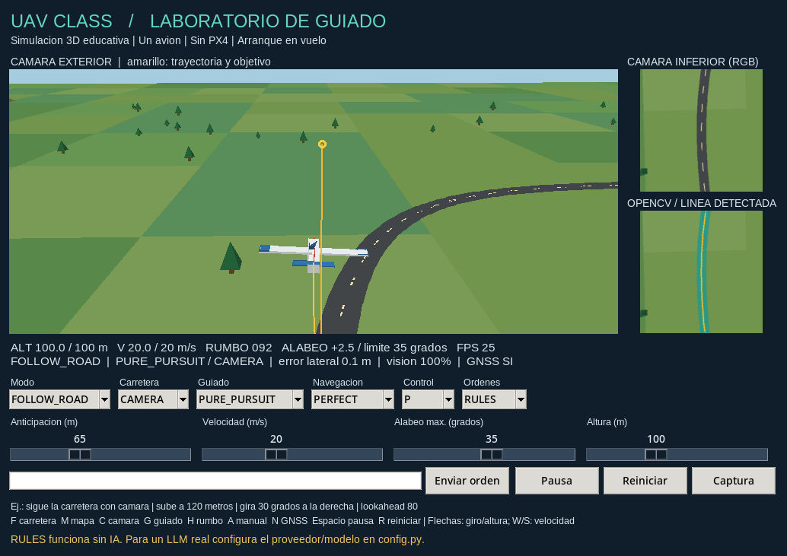

# UAV_CLASS
## Laboratorio 3D de navegacion, guiado, control y ordenes en lenguaje natural

Un avion de ala fija sigue una carretera sinuosa. Puedes cambiar el algoritmo,
la velocidad, el alabeo, la altura y el lookahead; elegir entre mapa y camara;
y dar ordenes escritas. Todo el codigo del proyecto es Python.



**Empieza ya en vuelo. No hay orbitas, despegue ni aterrizaje.** El objetivo es
trabajar sobre autonomia y guiado, no perder la clase calibrando un simulador.
No necesita PX4, Gazebo, Unity, ROS, GPU dedicada, una cuenta de API ni modelos 3D
externos. No modifica instalaciones anteriores ni termina procesos ajenos.

El renderizador es 3D en software (NumPy + Pillow), con proyeccion perspectiva,
triangulos, recorte cercano y dos camaras. Se ha preferido esta opcion a Panda3D
para eliminar otra instalacion. La interfaz es Tkinter; OpenCV procesa la imagen
inferior. No es un simulador aerodinamico de alta fidelidad.

## 1. Instalacion

**Referencia: Python 3.10 de 64 bits**, el utilizado en el curso. El codigo usa
sintaxis compatible con 3.9 y posteriores. La ejecucion se ha probado aqui en
Python 3.13.5/Linux; la disponibilidad de paquetes y Tk depende del sistema.
No es necesario cambiar la version de Python de tus otros proyectos.

### Ubuntu / Linux

Desde esta carpeta:

```bash
python3.10 -m venv .venv
.venv/bin/python -m pip install -r requirements.txt
.venv/bin/python main.py
```

Puedes sustituir `python3.10` por `python3` si ese interprete es el que deseas usar.
En Ubuntu, si faltan venv o Tk para el Python de la distribucion:

```bash
sudo apt install python3-venv python3-tk
```

Para Python 3.10 instalado aparte, instala los paquetes de venv/Tk correspondientes
a ese interprete. No uses `sudo pip` ni instales sobre tu entorno de PX4.

### Windows

En PowerShell, dentro de la carpeta:

```powershell
py -3.10 -m venv .venv
.\.venv\Scripts\python.exe -m pip install -r requirements.txt
.\.venv\Scripts\python.exe main.py
```

No hace falta activar el entorno, por lo que no se cambia la politica de ejecucion
de PowerShell. Si tienes otra version compatible, cambia `-3.10`.

### Proximas veces

```bash
# Con el entorno virtual activo:
python main.py
```

Tambien estan disponibles `run.sh` y `run.bat`. Solo ejecutan la aplicacion;
no instalan nada ni buscan procesos. La ventana se adapta en altura a la pantalla.

**Dependencias:** NumPy, Pillow y OpenCV headless. Tkinter viene con muchas
instalaciones de Python, pero en Linux suele ser un paquete del sistema.
`opencv-python-headless` SI sirve aqui: las ventanas las dibuja Tk, no OpenCV.

## 2. Primera prueba (sin modificar codigo)

1. Ejecuta `python main.py`. El avion empieza a seguir la carretera por mapa.
2. Observa la vista exterior, la imagen inferior y la deteccion de OpenCV.
3. Mueve **Anticipacion** de 65 a 100 m. Mira el punto amarillo que persigue.
4. Cambia **Carretera: MAP -> CAMERA**. Ahora el guiado solo recibe lo detectado.
5. Cambia **Guiado: PURE_PURSUIT -> VECTOR_FIELD** y compara las curvas.
6. Escribe `sube a 120 metros` y pulsa **Enviar orden**.
7. Escribe `gira 30 grados a la derecha`: cambia a HEADING, no gira sobre si mismo.
8. Escribe `sigue la carretera con mapa` para volver al seguimiento.

La camara inferior esta estabilizada: el borde superior de la imagen apunta hacia
el morro. No alabea con el avion. La carretera se proyecta sobre un suelo plano
usando la pose estimada y la altura. Esto es **guiado visual con pose conocida**,
NO localizacion visual sin GNSS.

El trazado de carretera es un circuito cerrado para repetir la prueba. Seguir un
circuito de carretera no introduce un modo de orbita alrededor de un objetivo.

## 3. Que cambiar y donde

Todas las selecciones iniciales estan al principio de **`config.py`**:

```python
FLIGHT_MODE = "FOLLOW_ROAD"      # FOLLOW_ROAD / HEADING / MANUAL
GUIDANCE_METHOD = "PURE_PURSUIT" # PURE_PURSUIT / VECTOR_FIELD
ROAD_SOURCE = "MAP"             # MAP / CAMERA
NAVIGATION_METHOD = "PERFECT"    # PERFECT / NOISY / FILTERED
CONTROL_METHOD = "P"            # P / PID
COMMAND_PARSER = "RULES"         # RULES / LLM

TARGET_ALTITUDE_M = 100.0
TARGET_SPEED_MPS = 20.0
LOOKAHEAD_M = 65.0
MAX_BANK_DEG = 35.0
```

Los cambios en `config.py` se cargan al **volver a ejecutar Python**. El boton
Reiniciar restaura los valores cargados al inicio del proceso, no recarga un archivo
editado desde fuera. Los desplegables, barras y comandos cambian la configuracion
en memoria al instante.

| Archivo | Responsabilidad | Donde experimentar |
|---|---|---|
| `main.py` | Bucle, ventana, entrada de usuario y registros | Lee `Simulation.step()` para seguir el flujo completo |
| `config.py` | Algoritmos, limites, ganancias, camara y proveedor LLM | Cambia primero este archivo |
| `world.py` | Terreno, carretera, geometria del avion y dos camaras | `make_road()`, `render_downward()`, `render_chase()` |
| `aircraft.py` | Dinamica simplificada y estado verdadero | `Aircraft.update_physics()` |
| `navigation.py` | Sensores sinteticos y estado estimado | `Navigation.estimate_state()` |
| `perception.py` | Imagen -> mascara -> linea -> puntos del terreno | `detect_road()`, `image_to_ground()` |
| `guidance.py` | Camino y estado -> referencia de alabeo | `pure_pursuit()`, `vector_field()`, `METHODS` |
| `control.py` | Referencias -> tasas y aceleracion limitadas | `Controller.update()` y `PID` |
| `autopilot.py` | Modos, seleccion del guiado y perdidas de referencia | `Autopilot.update()`, `set_mode()` |
| `commands.py` | Texto/LLM -> comando permitido -> validacion | `parse_rules()`, `call_llm()`, `validate_command()` |

No hay plugins, clases abstractas extensas ni una jerarquia de carpetas para cada
modulo. Los archivos principales estan en la raiz.

## 4. Modos, fuentes y algoritmos

Son elecciones independientes:

- **Modo:** FOLLOW_ROAD sigue la carretera; HEADING mantiene un rumbo objetivo;
  MANUAL permite solicitar alabeo con las flechas, manteniendo altura y velocidad.
  MANUAL es asistido, no equivale al modo Manual de PX4.
- **Fuente:** MAP usa coordenadas; CAMERA usa exclusivamente la imagen y la pose.
- **Guiado:** PURE_PURSUIT busca un punto adelantado; VECTOR_FIELD combina la
  tangente local y una correccion del error lateral. No son NPFG/L1 de PX4.
- **Navegacion:** PERFECT, NOISY o FILTERED. FILTERED es alpha-beta, **no EKF**.
- **Control:** P o PID educativo; no simula TECS ni la aerodinamica de las superficies.

El lookahead afecta a Pure Pursuit. En Vector Field, cambia `VECTOR_CONVERGENCE`.
No atribuyas un efecto al lookahead cuando has seleccionado Vector Field.

### Perder la carretera

CAMERA conserva una deteccion anterior solo durante `ROAD_LOST_TIMEOUT_S`.
Despues cambia a HEADING y avisa. **No cambia secretamente a MAP.** Pulsa F o
selecciona FOLLOW_ROAD para intentar recuperarla. HEADING no evita obstaculos ni
vuelve a casa: es una contingencia minima para estudiar la perdida de percepcion.

A poca altura, la camara puede no cubrir todo el lookahead. El objetivo se limita
al extremo del tramo realmente observado y se indica en el estado. No se inventa
carretera fuera del campo de vision.

## 5. Teclado y panel

**Haz clic sobre la escena para dar foco al pilotaje.** Pulsa Enter para escribir;
Escape devuelve el foco a la escena. Mientras escribes, las letras no controlan el
avion. Al perder el foco se liberan los mandos para evitar teclas enganchadas.

| Tecla | Accion |
|---|---|
| F | Activar seguimiento de carretera |
| M / C | Seguir por mapa / seguir por camara |
| G | Alternar Pure Pursuit y Vector Field |
| H | Mantener rumbo |
| A | Manual asistido |
| Izquierda / derecha | MANUAL: consigna de alabeo mientras pulsas; otros modos: cambia a HEADING y modifica el rumbo |
| Arriba / abajo | Subir / bajar la consigna de altura |
| W / S | Aumentar / reducir la consigna de velocidad |
| N | Activar / desactivar GNSS sintetico |
| Espacio | Pausa / continuar |
| R | Reiniciar la prueba con la configuracion inicial |

Las barras cambian altura, velocidad, lookahead y limite operativo de alabeo.
**Captura** guarda las vistas PNG; cerrar la ventana termina solo esta aplicacion.

## 6. Ordenes: sin IA y con un LLM real

### RULES: funciona desde el primer arranque, sin internet

Es un parser por reglas, **no se presenta como un LLM**. Usa numeros en cifras.

```text
sigue la carretera con mapa
sigue la carretera con camara
usa vector field
usa pure pursuit
sube a 130 metros
sube 20 metros
baja 15 metros
velocidad 22
reduce velocidad 3
reduce velocidad a 18
lookahead 90
alabeo maximo 25
gira 30 grados a la izquierda
rumbo 90
sigue la carretera con camara a 120 metros y a 18 m/s
```

`sube a 130` fija una altura; `sube 20` aumenta la consigna actual. Un giro relativo
se interpreta respecto al rumbo actual del avion al aplicar el comando.
No admite misiones secuenciales, condiciones tipo "cuando llegue", despegues,
aterrizajes, orbitas ni comandos para actuadores. Esos casos requieren ampliar
explicitamente el gestor, no solo cambiar el prompt.

Tambien admite un JSON escrito directamente:

```json
{"mode":"FOLLOW_ROAD","source":"CAMERA","lookahead_m":80,"speed_mps":18}
```

### LLM real: opcion conectable, no obligatoria

**Ollama local**, si ya tienes un servidor/modelo disponible:

```python
# config.py
COMMAND_PARSER = "LLM"
LLM_PROVIDER = "OLLAMA"
LLM_BASE_URL = "http://127.0.0.1:11434"
LLM_MODEL = "nombre-exacto-del-modelo-que-ya-tienes"
```

Tambien puedes usar un proveedor que implemente Chat Completions y JSON mode:

```python
LLM_PROVIDER = "OPENAI_COMPATIBLE"
LLM_BASE_URL = "https://tu-proveedor/v1"
LLM_MODEL = "nombre-de-un-modelo-compatible"
# La clave se lee de la variable de entorno UAV_LLM_API_KEY.
```

La compatibilidad depende del proveedor/modelo. No todos admiten los mismos campos.
El proyecto no instala Ollama, no descarga pesos y no incluye credenciales.

```bash
# Linux, solo para la terminal actual:
export UAV_LLM_API_KEY='tu-clave'
```

```powershell
# PowerShell, solo para la terminal actual:
$env:UAV_LLM_API_KEY='tu-clave'
```

El LLM devuelve un objeto JSON con campos permitidos. Ese objeto pasa por la misma
validacion que RULES. Una orden de 100 m/s se **rechaza** completa: no se aplica una
parte silenciosamente. No hay `eval`, `exec` ni ejecucion de codigo generado.

La peticion corre en un hilo separado. Si el LLM tarda, falla o responde mal,
el guiado anterior continua funcionando. Las respuestas pendientes se descartan
al reiniciar la simulacion. La conexion HTTP se ha probado con respuestas simuladas;
no se ha validado aqui una sesion con un proveedor o modelo externo real.

## 7. Camara, OpenCV y futura vision

El pipeline real es:

```text
Triangulos del mundo -> camara perspectiva inferior -> imagen RGB
  -> HSV + mascara de asfalto -> componente conectado
  -> centros por filas + ajuste cubico local
  -> proyeccion pinhole al suelo plano usando pose/altura estimadas
  -> trayectoria parcial -> el MISMO modulo guidance.py
```

Las lineas amarillas de ayuda y el modelo del avion NO aparecen en la imagen del
sensor. No se utiliza una segunda imagen sintetica perfecta para "hacer trampa".

Para cambiar el detector modifica `detect_road()`. Mantener el contrato
`PathObservation` permite sustituir el umbral por segmentacion neuronal mas adelante.
No se incluye YOLO, SLAM ni matching, porque son ampliaciones diferentes.

## 8. Registros y pruebas

Cada ejecucion crea `logs/fecha_hora/` con:

- `vuelo.csv`: estado verdadero/estimado, referencias, modo, errores y confianza.
- `config.json`: consignas iniciales.
- `ordenes.jsonl`: comandos aceptados y configuracion resultante.
- Capturas al pulsar el boton correspondiente.

El error verdadero se calcula SOLO para evaluar; no vuelve al guiado CAMERA.

```bash
python -m unittest discover -s tests -v
python tests/validate_flights.py
python main.py --headless --source CAMERA --seconds 30 --output prueba
```

`--headless` ejecuta la misma logica, incluida la camara renderizada y OpenCV,
sin abrir una ventana. No requiere una pantalla virtual.

Ver [resultados y limites de validacion](docs/VALIDACION.md). Ver tambien
[arquitectura y unidades](docs/ARQUITECTURA.md), [guion de clase](docs/GUIA_CLASE.md)
y [referencias](docs/REFERENCIAS.md).

## 9. Problemas habituales

**No module named tkinter:** instala Tk para tu interprete. Comprueba con
`python -m tkinter` antes de la clase.

**No module named cv2/numpy/PIL:** comprueba que ejecutas el Python de `.venv`.
Instala con ese mismo Python: `python -m pip install -r requirements.txt`.

**No necesito vision:** cambia `PERCEPTION_ENABLED=False`, `ROAD_SOURCE="MAP"`
y usa `requirements-minimal.txt`. Las dos camaras siguen viendose; no hay deteccion.

**Pocos FPS:** reduce `CHASE_WIDTH`, `CHASE_HEIGHT`, `CAMERA_SIZE`, `CAMERA_HZ`
y `ROAD_SAMPLES`. El integrador mantiene un paso fijo; en maquinas muy lentas el
reloj simulado puede avanzar mas despacio. La GUI muestra FPS.

**No responde a las flechas:** haz clic en la escena o pulsa Escape. El foco de la
caja de texto inhibe el pilotaje deliberadamente.

**La carretera desaparece al subir/bajar o girar:** observa la imagen inferior;
no toda combinacion de altura, FOV y giro garantiza deteccion. Cambia a MAP para
recuperar el trazado, o reinicia; no se recupera automaticamente por mapa.

**No gira lo suficiente:** comprueba velocidad y alabeo, no solo el algoritmo.
Para giro coordinado nivelado sin viento, `R = V**2 / (g*tan(bank))`.

**Entorno corporativo con certificados:** utiliza la CA proporcionada por tu
organizacion para pip/API; no desactives la verificacion TLS.

## 10. Limites del alcance

- Es un modelo cinematico con respuesta gradual, no un PX4 reimplementado.
- La velocidad minima es un limite artificial. No simula perdidas ni una envolvente certificada.
- Terreno plano, carretera sin cruces, iluminacion fija y detector deliberadamente simple.
- No hay deteccion de colisiones, evitacion de obstaculos, despegue ni aterrizaje.
- El renderizador CPU usa orden de profundidad, no un motor con z-buffer y fisica.
- Alpha-beta y dead reckoning son docentes; no sustituyen EKF, VIO ni INS.
- No hay adaptador PX4 implementado. Las interfaces estan documentadas para anadirlo.
- No conectar este codigo directamente a una aeronave fisica.
